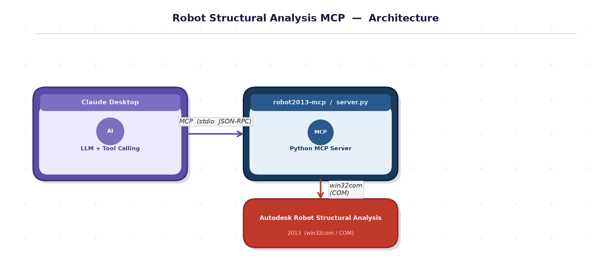
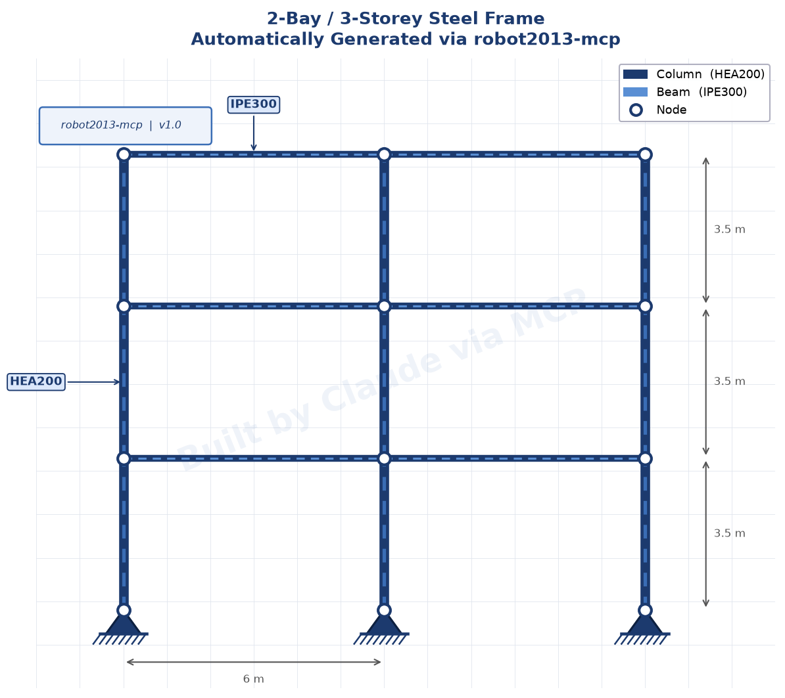
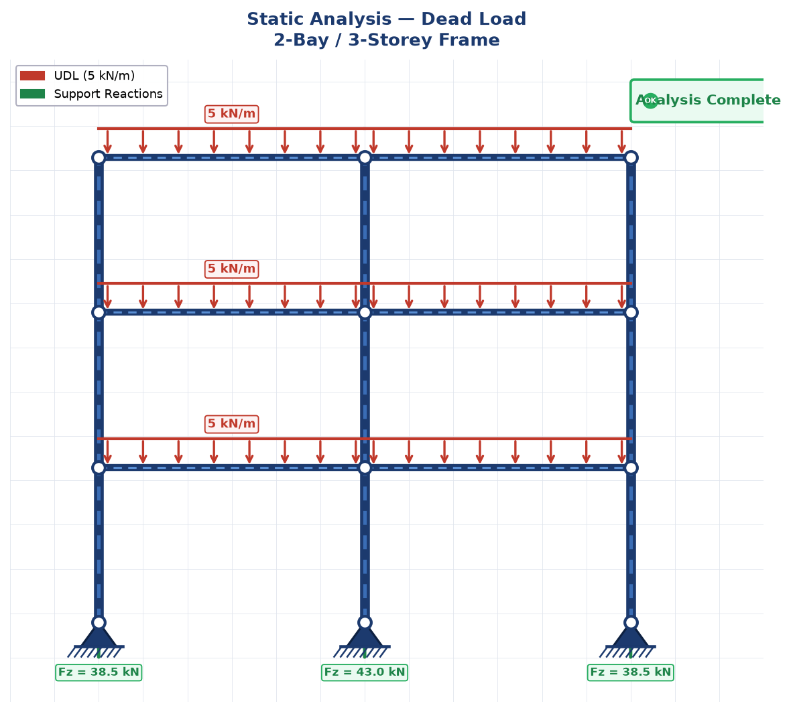

# Robot 2013 MCP Server

A Python **MCP (Model Context Protocol) server** that connects **Claude Desktop** to **Autodesk Robot Structural Analysis 2013** via Windows COM — letting you design, load, analyse, and read results from structural models using plain English.

---

## How it works

```
┌─────────────────────┐        MCP (stdio JSON-RPC)        ┌──────────────────────────┐
│   Claude Desktop    │ ◄─────────────────────────────────► │  robot2013-mcp server    │
│                     │                                     │  (server.py)             │
│  "Build a 3-storey  │                                     │                          │
│   steel frame..."   │                                     │  src/tools/              │
└─────────────────────┘                                     │  ├── model_write.py      │
                                                            │  ├── model_read.py       │
                                                            │  ├── loads.py            │
                                                            │  ├── analysis.py         │
                                                            │  └── results.py          │
                                                            └────────────┬─────────────┘
                                                                         │ win32com (COM)
                                                            ┌────────────▼─────────────┐
                                                            │  Autodesk Robot 2013     │
                                                            │  (running on same PC)    │
                                                            └──────────────────────────┘
```

---

## Why MCP instead of Claude Desktop alone?

Claude Desktop *can* control Robot without MCP — using computer-use (screen capture + mouse/keyboard). It works, but it is extremely expensive in tokens because every step requires a screenshot. A single task that takes **~500 tokens with MCP** can cost **500,000+ tokens** via screen control — a difference of **1,000× to 10,000×**.

MCP replaces pixel-by-pixel screen reading with direct structured API calls, making the same task faster, cheaper, and more reliable.

| | Claude Desktop (computer-use) | Claude Desktop + MCP |
|---|---|---|
| **How Claude sees Robot** | Screenshots of the UI — thousands of tokens each | Structured JSON responses — tens of tokens each |
| **Token cost per action** | ~5,000 – 50,000 tokens (screenshot + reasoning) | ~50 – 500 tokens (tool call + result) |
| **Cost to build a frame** | Could consume your entire daily quota | A fraction of a cent |
| **Speed** | Slow — waits for screen to render each step | Fast — direct COM call, no rendering needed |
| **Reliability** | Breaks if UI layout changes or a dialog appears | Unaffected by UI — talks directly to Robot's API |
| **Error handling** | Claude must read the error from a screenshot | Error text returned instantly in the tool response |
| **Runs headless** | No — Robot window must be visible | Yes — Robot can run hidden (`visible=false`) |

### Token cost comparison — build a 3-storey frame

```
Computer-use (screenshots):
  Launch Robot       ~10,000 tokens  (screenshot × 3 + clicks)
  Create nodes       ~30,000 tokens  (screenshot per node dialog)
  Create bars        ~40,000 tokens
  Set sections       ~20,000 tokens
  Run analysis       ~15,000 tokens
  Read results       ~20,000 tokens
  ─────────────────────────────────
  Total:            ~135,000 tokens   💸

MCP (this server):
  robot_launch              ~100 tokens
  robot_build_frame         ~200 tokens
  robot_create_case         ~80 tokens
  robot_add_bar_uniform     ~100 tokens
  robot_calculate           ~80 tokens
  robot_bar_forces          ~150 tokens
  ─────────────────────────────────
  Total:                ~710 tokens   ✅  (~190× cheaper)
```

> Real-world savings depend on model complexity. For large projects with hundreds of elements and multiple load cases, the gap widens further — easily **1,000× – 10,000× fewer tokens**.

### In practice

With MCP you just say:
> *"Build a 3-storey steel frame, apply dead loads, run analysis, show me the max bending moments."*

Claude executes 6 tool calls, each returning clean JSON. No screenshots, no UI navigation, no wasted tokens — **just results**.

---

## Requirements

| Requirement | Details |
|---|---|
| OS | Windows 10 / 11 (64-bit) |
| Robot | Autodesk Robot Structural Analysis 2013 (installed, licensed) |
| Python | 3.10 or later |
| Claude Desktop | Latest version with MCP support |

---

## Installation

**1. Clone the repo**
```bash
git clone https://github.com/your-username/RobotMcpPy.git
cd RobotMcpPy
```

**2. Install dependencies**
```bash
pip install -r requirements.txt
```

**3. Verify the server starts**
```bash
python server.py --list
```
You should see the full list of available tools printed to the console.

---

## Add to Claude Desktop (local setup)

There are two ways to add this server. **Method A (drag & drop)** is the quickest.

---

### Method A — Drag & drop the .mcp file *(easiest)*

**1.** Open `robot2013.mcp` in a text editor and update the path to match your machine:

```json
{
  "mcpServers": {
    "robot2013": {
      "command": "python",
      "args": ["C:/your/actual/path/to/RobotMcpPy/server.py"],
      "description": "Autodesk Robot Structural Analysis 2013 MCP Server"
    }
  }
}
```

> Use forward slashes `/` or double backslashes `\\` in the path.

**2.** Open Claude Desktop → click your **profile / settings icon** → go to **Extensions**.

**3.** Drag the `robot2013.mcp` file into the Extensions panel and drop it.

**4.** Claude Desktop reads the file and registers the server automatically — no JSON editing needed.

**5.** Restart Claude Desktop. The server will appear in the tools list.

---

### Method B — Edit config manually

### Step 1 — Find the config file

Open **File Explorer** and navigate to:

```
%APPDATA%\Claude\
```

> Tip: paste `%APPDATA%\Claude\` directly into the File Explorer address bar and press Enter.

Look for `claude_desktop_config.json`. If it does not exist, create it as an empty file.

---

### Step 2 — Find the full path to server.py

Open a terminal in the folder where you cloned this repo and run:

```bash
python -c "import os; print(os.path.abspath('server.py'))"
```

Example output:
```
C:\laragon\www\Mcps\RobotMcpPy\server.py
```

Copy that path — you will need it in the next step.

---

### Step 3 — Edit claude_desktop_config.json

Open `claude_desktop_config.json` in any text editor (Notepad, VS Code, etc.).

**If the file is empty or new**, paste this:

```json
{
  "mcpServers": {
    "robot2013": {
      "type": "stdio",
      "command": "python",
      "args": ["C:\\laragon\\www\\Mcps\\RobotMcpPy\\server.py"]
    }
  }
}
```

**If the file already has other MCP servers**, add only the `robot2013` block inside the existing `mcpServers` object:

```json
{
  "mcpServers": {
    "some-other-server": { ... },
    "robot2013": {
      "type": "stdio",
      "command": "python",
      "args": ["C:\\laragon\\www\\Mcps\\RobotMcpPy\\server.py"]
    }
  }
}
```

> **Important:** Use double backslashes `\\` in the path, not single `\`.
> Replace the path with the one you copied in Step 2.

---

### Step 4 — Restart Claude Desktop

Fully quit Claude Desktop (right-click the tray icon → Quit) and reopen it.

---

### Step 5 — Verify the connection

In Claude Desktop, click the **tools / MCP** icon (hammer icon or plug icon depending on version). You should see **robot2013** listed with all its tools.



To confirm it works, type in Claude:

> *"Call robot_health and tell me if Robot is running."*

Claude will call the tool and report back. If Robot is not open yet it will say so — that is expected.

---

### Troubleshooting

| Problem | Fix |
|---|---|
| `robot2013` does not appear in tools | Check the JSON is valid (no trailing commas). Use a JSON validator. |
| `python: command not found` | Use the full Python path, e.g. `C:\\Python311\\python.exe` |
| `Failed to import tools` error | Run `pip install -r requirements.txt` in the repo folder |
| Robot not found / COM error | Make sure Robot 2013 is installed and has been opened at least once manually first |

---

## Example: Claude builds a steel frame from scratch

The following shows a complete session — Claude calls the MCP tools automatically based on your natural language prompt.

### Step 1 — Ask Claude to build the model

> **You:** "Build a 3-storey steel frame with 2 bays of 6 m, storey height 3.5 m. Use HEA200 columns and IPE300 beams, S355 steel, fixed base."

Claude calls `robot_launch` → `robot_build_frame`:

```
┌─────────────────── Claude Desktop ───────────────────┐
│                                                       │
│  Used tool: robot_launch                              │
│  ✓ Robot started, new frame3d project created        │
│                                                       │
│  Used tool: robot_build_frame                         │
│  ✓ 12 nodes, 9 columns, 6 beams created              │
│    columnSection: HEA200                             │
│    beamSection:   IPE300                             │
│    storeys:       3                                  │
│                                                       │
│  The frame is ready in Robot. You can see it         │
│  in the 3D view.                                     │
└─────────────────────────────────────────────────────-┘
```



---

### Step 2 — Add loads and run analysis

> **You:** "Add a dead load of 5 kN/m on all beams and run a static analysis."

Claude calls `robot_create_case` → `robot_add_bar_uniform` → `robot_calculate`:

```
┌─────────────────── Claude Desktop ───────────────────┐
│                                                       │
│  Used tool: robot_create_case                         │
│  ✓ Case 1 "DL" created (static)                      │
│                                                       │
│  Used tool: robot_add_bar_uniform                     │
│  ✓ 5 kN/m (FZ) applied to beams 10 to 15            │
│                                                       │
│  Used tool: robot_calculate                           │
│  ✓ Analysis complete — results available             │
│                                                       │
└──────────────────────────────────────────────────────┘
```



---

### Step 3 — Read results

> **You:** "What are the maximum bending moments and support reactions?"

Claude calls `robot_bar_forces` → `robot_support_reactions`:

```
┌─────────────────── Claude Desktop ───────────────────┐
│                                                       │
│  Used tool: robot_bar_forces                          │
│  Max My: 42.3 kN·m at bar 12, x = 3.0 m             │
│                                                       │
│  Used tool: robot_support_reactions                   │
│  Node 1: FZ = 38.5 kN                               │
│  Node 2: FZ = 77.0 kN                               │
│  Node 3: FZ = 38.5 kN                               │
│                                                       │
│  Total vertical reaction: 154 kN ✓ (matches load)   │
└──────────────────────────────────────────────────────┘
```

---

## Available tools — complete reference

### Session & Connection

| Tool | What it does |
|---|---|
| `robot_health` | **Always call first.** Checks if Robot is running, returns Robot version, open project name/type, element counts, and whether results are available. |
| `robot_launch` | Starts Robot Structural Analysis if it is not already running. Waits until the COM server responds. Optionally creates a new project automatically. |
| `robot_set_interactive` | Controls whether Robot may show dialog boxes (`interactive`) and whether the Robot window is visible (`visible`). Use `visible=false` for background runs. |

### Project Lifecycle

| Tool | What it does |
|---|---|
| `robot_project_new` | Creates a new empty project. Supported types: `frame3d`, `frame2d`, `truss`, `shell`, `plate`. Refuses to overwrite a non-empty project unless `discardCurrent=true`. |
| `robot_project_open` | Opens an existing Robot project file (`.rtd`) from an absolute path. |
| `robot_project_save` | Saves the current project in place (no path) or to a new absolute `.rtd` path. |
| `robot_project_close` | Closes the current project **without saving**. Requires `confirm=true`. |
| `robot_project_info` | Returns project metadata: file name, type, element/case counts, results status, Robot version. |

### Model — Read (inspect the model)

| Tool | What it does |
|---|---|
| `robot_summary` | Model at a glance — node/bar/panel/case counts, bounding box, sections and materials in use, results status. Good starting point. |
| `robot_list_nodes` | Lists nodes with coordinates (m) and support label. Supports selection ranges like `1 4 7to12` or `all`. |
| `robot_get_node` | Detailed info on one node: coordinates, support definition, connected bars. |
| `robot_find_nodes_at` | Finds nodes at or near a given coordinate within a tolerance (default 1 mm). |
| `robot_list_bars` | Lists bars with start/end nodes, length, section, material, and gamma angle. Filterable by section or material name. |
| `robot_get_bar` | Detailed info on one bar: end nodes + coordinates, section properties, material, releases. |
| `robot_list_panels` | Lists panels/slabs/walls with thickness, material, area, structural type. |
| `robot_get_panel` | Detailed info on one panel: contour points, thickness label, material, area. |
| `robot_list_supports` | Lists all support labels defined in the project with their DOF restraints (UX/UY/UZ/RX/RY/RZ) and spring stiffnesses. |
| `robot_list_labels` | Lists all labels of a given type (section, material, support, release, thickness) defined in the project. |
| `robot_get_label` | Full definition of one label — use this to inspect a section's properties or a support's DOF settings. |
| `robot_list_cases` | Lists all load cases and combinations with id, name, nature (dead/live/wind…), and analysis type. |
| `robot_get_case` | Detailed info on one load case: every load record with its targets and values. |
| `robot_list_groups` | Lists named object groups (nodes, bars, panels, cases) defined in the project. |
| `robot_section_search` | Searches section names across the active databases. Use before `robot_create_bar` to find the correct section name. |
| `robot_material_database` | Lists materials in the material database, filterable by type (steel / concrete / timber / aluminium). |
| `robot_export_model_json` | Exports the entire model as JSON (nodes, bars, panels, load records). Optionally writes to a file. |

### Model — Write (create & modify geometry)

| Tool | What it does |
|---|---|
| `robot_create_node` | Creates a single node at (x, y, z) in metres. Reuses an existing node at the same position by default. Optionally assigns a support label. |
| `robot_create_nodes` | Creates many nodes in one call. Each item is `{x, y, z, number?, support?}`. More efficient than calling `robot_create_node` repeatedly. |
| `robot_create_bar` | Creates a bar between two node numbers or two coordinate points. Optionally assigns section, material, release, and gamma rotation. |
| `robot_create_bars` | Creates many bars in one call with shared `defaults` for section/material. More efficient than calling `robot_create_bar` repeatedly. |
| `robot_create_panel` | Creates a panel (slab / wall / shell) from a list of contour points `[[x,y,z], …]`. Optionally assigns thickness and material. Requires a `shell` or `plate` project type. |
| `robot_build_frame` | **Shortcut:** Generates a complete regular multi-bay multi-storey frame from parameters (bay spans, storey heights, sections, material, support type). Fastest way to model a typical building frame. |
| `robot_transform` | Moves, copies, rotates, or mirrors a selection of nodes/bars/panels. |
| `robot_delete` | Deletes nodes, bars, panels, or cases by selection string. Deleting `all` requires `confirm=true`. |
| `robot_clear_structure` | Deletes **everything** in the model. Requires `confirm=true`. |

### Model — Properties (sections, materials, supports, releases)

| Tool | What it does |
|---|---|
| `robot_create_section` | Defines a section label: load from database by name, or create parametrically (shapes: `rect`, `box`, `i`, `tube`, `t`, `c`) with dimensions in mm. |
| `robot_create_material` | Defines a material label: load from database, or specify properties (E, ν, density, fy, fu) manually. |
| `robot_create_support_label` | Creates a named support label from explicit DOF flags and spring stiffnesses without assigning it to any node. |
| `robot_set_bar_section` | Assigns a section (and optionally material) to a selection of bars. Loads the section from the database if not already in the project. |
| `robot_set_bar_material` | Assigns a material to a selection of bars. Loads from the database if needed. |
| `robot_set_bar_release` | Assigns end releases to bars: use a preset (`pinned`, `pin-fix`, `fix-pin`, `truss`) or define custom DOF flags per end. |
| `robot_set_support` | Assigns supports to nodes: use a preset (`fixed`, `pinned`, `roller_x`, `roller_y`), an existing label, or explicit DOF flags + spring stiffnesses. |
| `robot_set_panel_thickness` | Creates or updates a thickness label and assigns it to a selection of panels. |

### Loads

| Tool | What it does |
|---|---|
| `robot_create_case` | Creates a load case with an id, name, nature (`dead`, `live`, `wind`, `snow`, `temperature`, `accidental`, `seismic`), and analysis type (`static`, `modal`, `buckling`). |
| `robot_add_nodal_load` | Applies a force (kN) and/or moment (kN·m) to selected nodes in a load case. |
| `robot_add_bar_uniform` | Applies a uniform distributed load (kN/m) to selected bars along global or local X/Y/Z axes. |
| `robot_add_bar_trapezoidal` | Applies a trapezoidal distributed load with varying intensity from bar start to bar end (kN/m). |
| `robot_add_bar_point` | Applies a concentrated (point) load on bars at a position along the bar (0.0 = start, 1.0 = end, or absolute distance). |
| `robot_add_self_weight` | Adds a self-weight load record to a case. Factor default is `-1.0` (downward gravity). |
| `robot_create_combination` | Creates a load combination from component cases with factors (e.g. `1.35 DL + 1.5 LL`). Supports `uls`, `sls`, `acc` combination types. |
| `robot_delete_case` | Deletes a load case or combination by id. |
| `robot_delete_load_records` | Deletes all load records of a given type from a case, or clears all records in a case. |

### Analysis

| Tool | What it does |
|---|---|
| `robot_calculate` | Runs the structural analysis (static / modal / buckling). Generates the FE model first if needed. Returns whether results are available. |
| `robot_generate_model` | Generates the finite element model (meshes panels, applies boundary conditions) without running the analysis. |
| `robot_mesh_panels` | Meshes all panels with a target element size (m). Equivalent to Robot's automatic mesh generation. |
| `robot_analysis_status` | Checks analysis status: whether results are available and case count. Use after `robot_calculate` to confirm. |

### Results

| Tool | What it does |
|---|---|
| `robot_bar_forces` | Internal forces for selected bars and cases: FX (axial, kN), FY/FZ (shear, kN), MX (torsion, kN·m), MY/MZ (bending moments, kN·m). Query at start / mid / end or custom positions. |
| `robot_bar_stresses` | Stresses for selected bars and cases: Smax, Smin, SmaxMY, SmaxMZ, SminMY, SminMZ, FXSX (axial). Values in MPa. |
| `robot_bar_displacements` | Transverse deflection along bars (local UX, UY, UZ in mm) for selected cases. |
| `robot_node_displacements` | Node displacements and rotations: UX, UY, UZ (mm), RX, RY, RZ (mrad) for selected nodes and cases. |
| `robot_support_reactions` | Support reactions at supported nodes: forces in kN, moments in kN·m. |
| `robot_extremes` | Envelope extremes (max, min, absMax) of one result component across all selected objects and cases. Use this to find the governing design value (e.g. max MY across all beams and all cases). |
| `robot_results_csv` | Exports bar forces, node displacements, or reactions to a CSV file at a given path. |

### Design Codes & Norms

| Tool | What it does |
|---|---|
| `robot_get_norms` | Returns all active design codes set for this project (steel, connections, timber, concrete, foundation, loads, seismic, bridges, basis). Inspect before running a design check. |
| `robot_set_norm` | Sets the active design code for one discipline (e.g. set steel to `EN 1993-1-1:2005/AC:2009`). Use `robot_get_norms` first to see the current format. |

---

## Useful prompts to try

```
"Check if Robot is running and connected."

"Create a new 3D frame project and build a 2-bay 4-storey frame,
 6 m bays, 3 m storeys, HEA200 columns, IPE360 beams, S355, fixed base."

"Add a self-weight case and a live load of 10 kN/m on all beams,
 then create a combination 1.35 DL + 1.5 LL."

"Run static analysis and show me the maximum bending moments
 and vertical reactions."

"Save the model to C:\Projects\my_frame.rtd"
```

---

## Project structure

```
RobotMcpPy/
├── server.py              # MCP server entry point (stdio JSON-RPC)
├── src/
│   ├── robot_client.py    # COM connection wrapper
│   └── tools/
│       ├── registry.py    # Aggregates all tools
│       ├── session.py     # Project lifecycle
│       ├── model_read.py  # Read geometry
│       ├── model_write.py # Write geometry & properties
│       ├── loads.py       # Load cases & records
│       ├── analysis.py    # Run & status
│       ├── results.py     # Forces, reactions, displacements
│       └── preferences.py # Norms & settings
├── manifest.json          # MCP manifest
├── pyproject.toml
└── requirements.txt
```

---

## License

MIT
